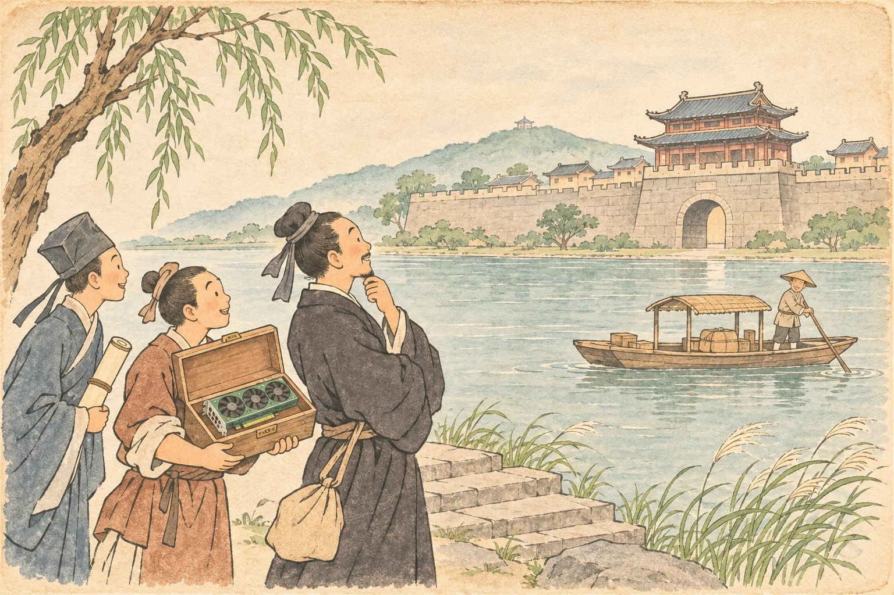

*A pastiche of the Life of Wu Zixu, adapted from a story by Ranni on Zhihu. The events, dialogue, and conduct depicted here are fictional.*

<!--break-->

*AI-generated illustration.*

Jensen Huang was of Eastern descent and served America. He founded Nvidia and aided America with its graphics cards. In time America used artificial intelligence to give orders to the world, and in every realm those who practiced that art depended on Nvidia. The great kingdom in the East had many people and thriving trades, yet it, too, got its best chips from Nvidia.

Before long the Eastern kingdom grew stronger by the day. The king of America took alarm and sought to bar the sale of graphics cards to the East. Huang advised him: “I have heard that a good fisherman does not take away his bait for fear the fish may grow. The East seeks our graphics cards as hungry men seek grain. Sell to them, and they will depend on us. Cut off trade, and they will make their own. They buy from us today because they cannot make their own. If they cease to buy one day, who can say it will not be because they have learned how?” The king thought this sound.

Then the minister Dario came forward. “Huang is a merchant,” he said. “He knows the profit in selling his wares. What can he know of the security of the realm? The East strives day and night to catch us, and to give it our finest tools is to provision an enemy. Huang serves here, but his family comes from the East. Is his heart truly here? I beg Your Majesty to look into it.” The king thought this sound as well and issued the ban.

Huang advised him again. “If you would have men depend on your grain, keep selling it to them. Your Majesty would bar them from buying and forbid them to plough. I do not see how this can work. Cut them off now, and when you wish to sell again, it may be too late.” The king was displeased. He said to his attendants, “Huang has served me well, but he is a merchant. Shall the great affairs of the realm be settled by what comes out of his mouth?” He set Huang's counsel aside. The more often Huang spoke, the more the king kept him at a distance.

About this time a rumor went around that Huang was seeing an Eastern woman named Huang Le in private. Dario seized on it and spoke against him. “Huang has repeatedly asked you to give the East our best tools. Each time you declined, he pressed you harder. Now he keeps company with a woman from the East. She may be their spy, for all we know. Here is a minister who obstructs your orders at home and cultivates ties abroad. If Your Majesty does not act soon, I fear he will bring trouble upon us.” The king said, “I suspected as much before you spoke.” He sent an envoy to Huang with a sword and the order, “Take your own life.”

Huang looked up to heaven and sighed. “Alas! I founded Nvidia, and through it the other realms came to depend on America. When the king could hold his chips over the whole world, did I have no share in that? I knew the East could bring us trouble, so I sought to keep it dependent on us. Now the king listens to slander, puts me to death, and drives the East to make its own chips. I can see the fall of America already.”

He turned to his retainer. “When I am dead, take out my eyes and hang them above the east gate of Silicon Valley. I wish to see the East break America with its computing power.” He cut his throat. When the king heard his last words, he was enraged. He had Huang's body put in a leather sack and cast adrift in the Pacific.

Unable to buy the cards, the Eastern kingdom assembled its craftsmen and scholars, who labored day and night at the art of making chips. After several years their chips were ready, and their computing power was several times America's. Those who worked in artificial intelligence the world over rushed to use the Eastern graphics cards. The king took fright, lifted his ban, and sent word to the East: “You may come and buy now.” The Eastern envoy replied, “We once wanted to buy, and the king would not allow it. Now we can make our own. What need have we to buy?” The king said nothing.

Afterward the East used its computing power to break America's computing centers, and the other realms vied to submit to it. Defeated, the king wept. “How shall I face Huang in the world below?” He cut his throat, and America fell.

**The Grand Historian says**

How deep slander can sink into a man's heart! When Huang founded Nvidia, the king used its tools to make the other realms fear him. Once Huang's words became hard to hear, the king cast aside a lifetime of service. A rumor about a woman sufficed to condemn a minister to death. How grievous!

Had the king taken Huang's counsel and let the East buy graphics cards year after year, even a powerful East would still have needed America. When the East sought the cards, the king feared it would get them. Once the East could make them, he feared it would never ask again. It was the king who first refused to sell, and the king who in the end went looking for a buyer. He could grant Huang a sword while the East had no chips of its own. Once its computing power surpassed his, could he raise Huang from the dead to ask his counsel again?

Adapted from [Ranni's original story on Zhihu](https://www.zhihu.com/question/1985470887412131189/answer/2105060044979152509) and modeled on [the Life of Wu Zixu in volume 66 of the Records of the Grand Historian](https://zh.wikisource.org/wiki/史記/卷066).
