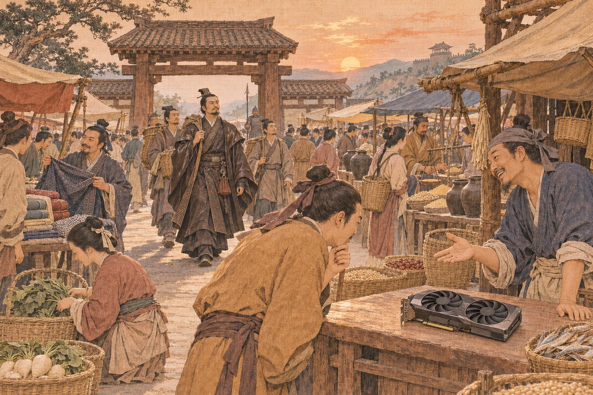

Jensen Huang founded Nvidia. In the beginning its graphics cards were sold to those who played games. When artificial intelligence arose, practitioners from every quarter vied to buy his wares. Some bought the devices to rent out their power, and some built great halls to house them. When Huang spoke before a crowd, men often began bidding for his shares before they had even seen the devices.

<!--break-->

*AI-generated illustration.*

On the twelfth day of the eleventh month, the directors of Nvidia gave notice that Huang had laid down his office and the keeper of the accounts would hold it in his stead. On that day Nvidia shares fell hard on Wall Street, then recovered somewhat before the close. After some days Huang wished to return, but the directors at first would not have him. As prices fell further, there were men who had once scrambled for the shares who now spent all day at the market and changed their minds several times.

A guest said to the directors, “You count Master Huang's departure as the loss of one man. Those who build halls for machines reckon next year's demand, and those who put up the money reckon next year's return. The devices are still here, and so are the craftsmen. What they ask is who will be in charge of next year's affairs.”

One director said, “If the master of one shop goes away, how is it that the shops beside it also have fewer customers?”

“Look at the market,” replied the guest. “The man who rents out computing power has need of the man who sells the cards. Those who build the halls have need of the man who rents out the power, and those who lend the money have need of the builders. Let one shop change hands, and the rest must count their tallies anew. They hold shares in different houses, yet the thing they hope for may be the same.”

On the twenty-third day, the directors met and restored Huang to office. Those who governed America had also been consulted. On that day Nvidia shares soared, and many stocks on the Nasdaq rose with them. Some said the market that was empty yesterday could fill again. The following day Nvidia gave up some of its gains, and the Nasdaq fell as well.

A trader rejoiced at Huang's return and said to a fellow, “Those who threw these shares away the other day. Where have so many of them come from now?” His fellow said, “Have you never seen the morning market? At dawn the people come with their wares. At dusk each goes home. The market stands where it stood. Each man comes for something of his own.” The trader looked down at the shares he held and said nothing for a long while.

**The Grand Historian says**

Tian Wen was minister of Qi. When the king dismissed him, his guests all left. Feng Huan went west to persuade Qin to take him in. Fearing that Qin would employ him, the king of Qi restored Tian Wen to office. Tian Wen resented the guests who had gone away, and Feng Huan answered him with the story of the morning market. Look now at Wall Street. Before Huang returned, the shares had already passed from hand to hand. When he returned, the company had gained no new machine hall, yet the price had already moved. A market can fill in a day. A hall for machines cannot be built in a day.

Reference: [Records of the Grand Historian, volume 75, The Life of Lord Mengchang](https://zh.wikisource.org/wiki/%E5%8F%B2%E8%A8%98/%E5%8D%B7075)
