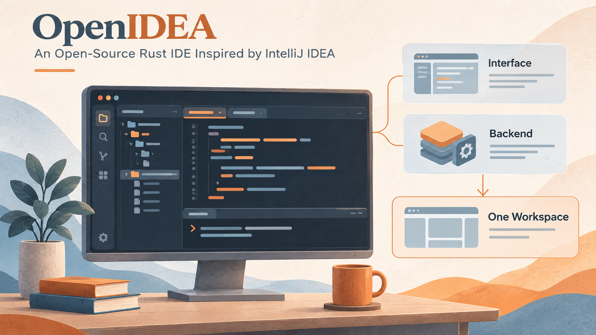

I recently came across an open-source project worth sharing: [OpenIDEA](https://github.com/l0ng-ai/openidea). If you are used to IntelliJ IDEA's shortcuts, tool windows and search workflows, and want to try a lighter development tool, it is worth a look.

The version I run on Windows uses roughly 600 MB of memory, including the main program and its WebView2 child processes. I have also made a small customization to suit my workflow.
<!--break-->

*AI-generated conceptual illustration of the workspace components, not an actual OpenIDEA screenshot.*

## Familiar IDEA workflows, with a different implementation

OpenIDEA has a Rust core and uses Tauri for its desktop application. Its interface follows IntelliJ IDEA conventions, including shortcuts, tool windows and Search Everywhere. These familiar entry points make it easier for IDEA users to know where to look.

According to the [official project description](https://github.com/l0ng-ai/openidea), it covers editing, code insight, debugging, Git, terminals, database and HTTP clients, with support for over 60 languages and builds for Windows, macOS and Linux. It uses the Apache 2.0 license and is not affiliated with JetBrains.

“A lightweight IDEA” is a useful way to describe its direction, but choosing an IDE still depends on the project. Browsing code, navigating definitions, searching and reviewing diffs place different demands on a tool from deep framework analysis, refactoring and an extensive plugin ecosystem. Familiar controls can make it easier to get started; whether the capabilities are sufficient needs testing with your own project.

## Why I have switched from Zed for now

I previously recommended Zed in my post on [choosing and adapting development tools](/en/2026/10/22/ai-era-developer-toolkit/) and made some customizations for my own use. My temporary switch to OpenIDEA comes down to two main reasons.

The first is familiarity. IDEA's file search and Git tools have always suited the way I work. OpenIDEA brings me back to familiar search entry points, shortcuts and diff views. Finding files and checking changes fit my habits better. Coming from Zed, that familiarity feels good and reduces the effort of adapting to different controls.

The other reason is Java code navigation. In my previous Zed setup, following code and navigating definitions did not fully meet my needs. After adding the Java language server (LSP) and related tools, memory use across the editor and associated processes reached roughly 2 GB. For the projects and configuration I was using, adding those capabilities made the low-memory advantage I had valued less apparent.

For now, I prefer to use OpenIDEA for everyday code reading and editing, keeping familiar IDEA workflows while continuing to see how it handles Java projects. This is a choice based on my current needs, and I will keep adjusting it as the tools and projects change.

## The everyday development tools are together, too

Alongside familiar search and navigation, OpenIDEA includes running and debugging, Git, database and HTTP clients, and a terminal. A few capabilities stand out:

- **Java development**: Maven/Gradle dependency synchronization, run configurations and breakpoint debugging, with additions such as [Tomcat configurations](https://github.com/l0ng-ai/openidea/pull/392) and [class-file decompilation](https://github.com/l0ng-ai/openidea/pull/657).
- **Git and reviews**: diffs, commit history and inline blame, plus a [GitHub PR tool window](https://github.com/l0ng-ai/openidea/pull/477) for inspecting changes and review feedback inside the IDE.
- **Supporting tools within the project**: query a database, send HTTP requests and run terminal commands without switching applications each time.

Together, these give it the shape of a fairly complete IDE workspace. Whether they cover a particular project's needs still depends on how its language services and tools perform in practice.

## Coding agents can sit beside the code

OpenIDEA also has an Agents workspace. Its source provides native protocol adapters for Claude Code and Codex, alongside ACP integration paths; see the [agent implementation](https://github.com/l0ng-ai/openidea/tree/main/crates/ide-agent/src). Upstream also supports [docking a conversation in the Agents tool window](https://github.com/l0ng-ai/openidea/pull/588), allowing different arrangements of the conversation and editor.

This layout fits a common development workflow: ask an agent to read the code and make a change, then inspect the affected files and diffs alongside it. If its understanding needs correcting, add instructions with the relevant code in view. With the conversation, editor and Git tools together, you can still check the results section by section.

For example, start with a bounded request: “Add a date filter to the list, follow the existing parameter format, and run the relevant tests.” Afterward, inspect the diff for matching frontend and backend fields, default values and clearing behavior before accepting it. The useful part is having a result you can inspect, beyond the conversation itself.

Agent installation, authentication and model costs still depend on the tools and services you connect. OpenIDEA provides an interface for organizing these operations; an open-source IDE does not make model calls automatically free.

## Rapid updates, with signs of AI-assisted maintenance

When I noticed the project last week, it had only **around 800 stars**. A week later, on **November 4, 2026**, that number had already grown to **around 5,800**. Development is busy, too: when I checked upstream a couple of days ago, it was already 200 commits ahead of my local baseline. Between midnight and 2 p.m. on November 4, China Standard Time, [main-branch history](https://api.github.com/repos/l0ng-ai/openidea/commits?per_page=100&since=2026-11-03T16%3A00%3A00Z&until=2026-11-04T06%3A00%3A00Z) alone recorded 89 commits, including community contributions and changes merged into the branch.

The updates include both new features and fixes to everyday issues such as Maven dependency refreshes, Java breakpoints on Windows and Spring Boot resource updates. Watching the steady stream of commits, I wondered whether the author had put AI to work helping maintain the project around the clock.

The repository does have agent-oriented development workflows: [AGENTS.md](https://github.com/l0ng-ai/openidea/blob/main/AGENTS.md) sets out coding and verification rules; [`issue-fix`](https://github.com/l0ng-ai/openidea/blob/main/.agents/skills/issue-fix/SKILL.md) covers reproduction, fixes and opening a PR; and [`verify`](https://github.com/l0ng-ai/openidea/blob/main/.agents/skills/verify/SKILL.md) requires launching the actual application, operating its interface and saving verification evidence.

These clues suggest that AI likely participates in ongoing development and verification. Public records cannot establish whether automation runs continuously or how much human review is involved. An IDE that supports agents also organizing its own maintenance around them is interesting in itself.

## Open source leaves room for personal workflows

My customized version is available at [enilu/openidea · feature/single-window-projects](https://github.com/enilu/openidea/tree/feature/single-window-projects). If you want to keep several project shortcuts in one window and switch the active project as needed, take a look at this branch.

In my version, I added a window project sidebar that keeps a list of frequently used projects, switches between them and collapses into an icon rail. A window activates only one project at a time. Switching closes the previous project's services before restoring the next project's editor session.

These features were added in my personal branch. Keeping project shortcuts visible while running only the current project in the background is the workflow I want to preserve.

Upstream subsequently added [multi-project workspaces and window groups](https://github.com/l0ng-ai/openidea/blob/main/docs/workspaces-and-window-groups.md). A workspace brings several projects into one session for search, indexing and running. A window group switches between project tabs while keeping member sessions and services alive. Those choices differ from my approach of activating only one project, so future synchronization needs to handle opening, closing and restoring projects carefully.

Being able to inspect the implementation, adapt it to a need and continue following upstream is part of the project's appeal for me. Maintaining a personal branch also has a cost, especially when upstream starts changing the same features.

Project: [l0ng-ai/openidea](https://github.com/l0ng-ai/openidea). Installers are available from [Releases](https://github.com/l0ng-ai/openidea/releases).
