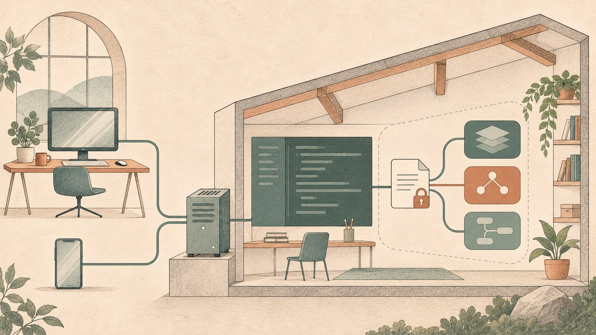

Asking AI to change a feature usually involves more than typing a request. You choose a project and branch, inspect changed files, run tests and open the application to check its behavior. With several tasks underway, you also switch between terminals and conversations.

Paseo organizes these activities in one workspace interface. It uses installed coding agents underneath, provides projects, workspaces, conversations and result inspection above them, and lets a phone connect to the same development environment. I mentioned it in my post on [choosing and adapting development tools](/en/2026/10/22/ai-era-developer-toolkit/). This article focuses on its features and practical uses, followed by a shorter account of my customizations.
<!--break-->

*AI-generated conceptual illustration of the workflow, not a product screenshot or an exact network diagram.*

The official website is [paseo.sh](https://paseo.sh/), and the source is at [getpaseo/paseo](https://github.com/getpaseo/paseo). My fork is [enilu/paseo](https://github.com/enilu/paseo); its customizations discussed here are on the `suzhou` branch.

## One workspace interface for several coding agents

Paseo supports coding agents including Claude Code, Codex, GitHub Copilot, OpenCode and Pi, with desktop, mobile, web and CLI interfaces. When creating a task, you select a configured provider and model, then follow its work through a common interface. See the [official project description](https://github.com/getpaseo/paseo).

For me, the most practical use is choosing an agent and model according to the task's importance and the cost I want to invest. My main combinations are:

| Task | Agent and model | What I prioritize |
| --- | --- | --- |
| Important work, including development tasks at work | Codex + GPT-6.1 | Implementation quality, handling complex problems and verifying delivery |
| Lighter tasks, such as online games and educational tools for my child | OpenCode + DeepSeek, using a paid service | Balancing results and usage costs while iterating on small features |
| Lightweight experiments and prototypes | OpenCode + available free models, such as Space Bunny, which I have used | Trying ideas at low cost and producing an interactive first version |

There are three layers here: **Paseo is the workspace interface; Codex and OpenCode are agents executing tasks; GPT-6.1, DeepSeek and others are the models those agents call.** To use DeepSeek this way, I configure its service in OpenCode, then use that agent through Paseo. DeepSeek also publishes an [OpenCode integration guide](https://api-docs.deepseek.com/quick_start/agent_integrations/opencode/).

This keeps project and workspace navigation consistent while letting me change the underlying combination. I prioritize Codex with GPT-6.1 for work-related development. For games and educational tools for my child, I more often use OpenCode with paid DeepSeek or try whichever free models are available. This describes my allocation of work, rather than a model ranking. Free model offerings, quotas and availability can change; the actual service determines what is available.

Tools, permissions and history formats still differ between agents. Switching executors does not transfer all context automatically; code, task descriptions and verification records remain useful for handoffs.

The architecture is straightforward: **a daemon on the development machine manages agent processes, while clients handle presentation and interaction.** That machine can be your computer or a server you maintain. Its environment determines where tasks execute, dependencies are installed and files are saved.

Self-hosting lets you reuse your tools and development environment. Model calls still follow the agent's configuration and do not automatically become offline inference.

## Give parallel tasks their own workspaces

Suppose a project needs list filtering and an export bug fix. You want both to progress concurrently, with separate changes and validation.

Paseo organizes tasks into workspaces. A workspace holds agent conversations and brings together files, diffs and running results around the same code. For independent changes, Git worktrees provide separate working directories and branches.

A concrete workflow is:

1. Create a workspace for filtering, selecting the project, starting branch and New worktree isolation.
2. Create another workspace for the export fix from the same base branch.
3. Choose agents, define each task's scope and verification requirements, and run both concurrently.
4. Switch workspaces in the sidebar to inspect progress and add instructions, then review and merge each change separately.

Both tasks can use the same provider or different ones. You can also try alternative implementations of one requirement in separate workspaces and compare them. See the [official parallel development guide](https://paseo.sh/docs/parallel-development).

Keep workspaces and conversations distinct: agents inside one workspace share its working directory. Independent edits need separate worktrees. A second agent reviewing the current diff can stay in the same environment, with explicit instructions not to edit files.

Worktrees separate files and branches, while services still share machine resources. Two frontend development servers need different ports, for example.

## Move from “finished” to results you can inspect

After an agent says it has finished, you still need to inspect changes and run checks. Paseo puts those entry points beside the conversation in the same workspace.

On desktop, Changes displays diffs, Files lets you browse and edit source, and split panes keep code alongside the conversation. Open the workspace terminal to run project commands when verification is needed. Questions about a change can then refer directly to the actual diff.

For web projects, desktop browser tabs can open a development server. With browser automation configured, you can also ask an agent to check specific interactions. Giving it a URL, steps and expected behavior produces more verifiable output than asking it to “test the app.” These entry points are covered in the [review and run workflow](https://paseo.sh/docs/parallel-development).

For the filtering task, for example, inspect the request parameters and state-management diff, run relevant tests, then open the page to check filtering and clearing. You do not have to delegate every step to AI; the workspace lets you and the agent discuss the same results.

## Use your phone to follow the same task after leaving your desk

Cross-device access is one of Paseo's distinctive uses. An agent continues running on a computer or server while the phone connects as a client to view its output, add instructions or handle interactions.

For example, start a lengthy task at your desk and check its progress from your phone later. If the agent has misunderstood something, send a clarification. The phone accesses the original execution environment, without cloning the repository or installing dependencies again. Changing screens does not create a separate project environment.

Official connection options include Relay and Tailscale; desktop and CLI clients can also reach an existing daemon over SSH. Relay must be enabled explicitly and uses end-to-end encryption. Available transports and setup steps vary by client; see the [connectivity documentation](https://paseo.sh/docs/connectivity).

The original machine still needs to stay online. A phone suits checking progress and adding instructions; large diff reviews and complex debugging are more comfortable at a desk.

## Voice, schedules and agent coordination add other ways to work

Voice input can help when composing a longer request on a phone. Paseo provides dictation and voice conversation modes: dictation turns speech into input, while voice mode supports spoken interaction with the coding environment. Speech processing can use local models or cloud services. Recognition languages depend on the model, so check language support when working in Chinese. See the [voice documentation](https://paseo.sh/docs/voice).

Voice suits background explanations and additional ideas. Check the transcription of paths, API fields and exact commands.

Schedules address recurring work. They start a new task in a specified repository with selected agent settings on a configured cadence. Heartbeats periodically prompt an existing conversation to reassess state and continue. A daily issue roundup suits a new task; following one particular build is closer to recurring checks within an existing conversation. See the [schedules documentation](https://paseo.sh/docs/schedules).

Paseo also provides agent coordination. With the relevant tools enabled, an agent can create other agents, delegate research or review, check progress and collect results. Corresponding operations are available through the CLI. This suits work with explicit responsibilities, such as requesting an independent review after implementation, without manually relaying every instruction. See the [orchestration documentation](https://paseo.sh/docs/orchestration).

## My fork mainly addresses three everyday needs

The preceding sections describe Paseo's own features and workflows. My fork concentrates on access, sharing and delivering results.

### Project and workspace access codes

The fork adds separate access codes for projects and workspaces. Project names remain visible, but viewing or creating their workspaces requires unlocking. Workspace titles remain visible too; opening the timeline, continuing conversations and creating agents requires access.

This retains sidebar navigation while restricting content. Names and titles are not hidden, so they should not contain sensitive information. This is access control within the instance, rather than system-account or execution-environment isolation.

### Session sharing with explicit collaboration

To show someone requirement discussions, changes in approach and final conclusions, I added encrypted session sharing. By default, it creates a read-only snapshot from the moment of sharing. Recipients use the complete link without signing in to Paseo; later conversation changes do not update the snapshot automatically.

Content is encrypted on the client, with the key in the URL's `#` fragment. The complete link carries the ability to decrypt it, so choose recipients according to the content's sensitivity. Shell tool-call records are filtered, but text and other results can still contain code or business information. This is not comprehensive redaction.

For further participation, the creator can explicitly enable collaboration, which defaults to off. The sharing page can then read the specified agent's timeline and send it messages, with the server restricting access to that session. Current collaboration credentials last seven days, and the original daemon and Relay connection must remain available.

The distinction is practical: a snapshot invites someone to review the process; collaboration lets them participate in ongoing work. Messages can cause the agent to edit code or run commands, so its existing execution permissions matter. See the [share creation implementation](https://github.com/enilu/paseo/blob/suzhou/packages/app/src/agent-sharing/create.ts).

### File delivery and local usability

File previews gain a download button, and assistant file downloads handle different transports. After inspecting a result from another device, you can save the file there.

Windows changes address file links containing Chinese characters, spaces and URL encoding, along with exact absolute project paths outside the home directory. Other additions include a native Codex history visibility setting, recently active workspace ordering, prompt-language titles, and background and opacity settings.

Custom desktop builds can disable automatic updates, with manually maintained release notes supporting a controlled upgrade process. These changes are recorded in the [fork's release notes](https://github.com/enilu/paseo/blob/suzhou/packages/app/src/release-notes/release-notes.ts) and subsequent commits. Features obtained by integrating upstream remain credited to upstream.

## Start with one real task

Paseo is worth trying if you use several agents, work on concurrent tasks or want to follow development after leaving your desk. Prepare at least one installed and authenticated agent CLI, then start with the [official desktop app](https://paseo.sh/download) or [getting-started documentation](https://paseo.sh/docs).

Start with a familiar repository and a small change, then inspect the diff, run tests and check the behavior. Once that workflow feels useful, add parallel tasks and remote access, judging whether they reduce switching and environment recovery.
