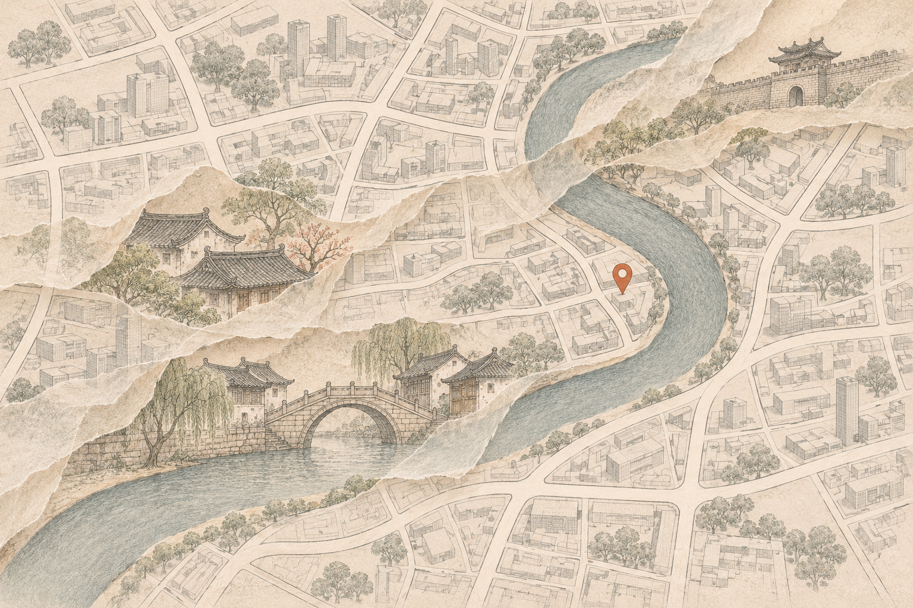
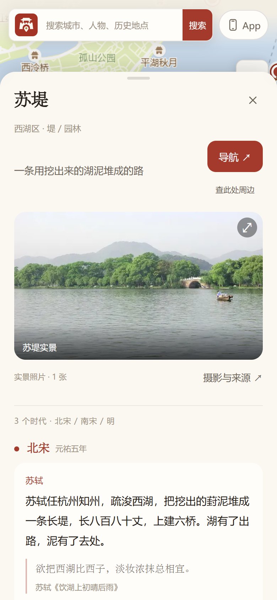
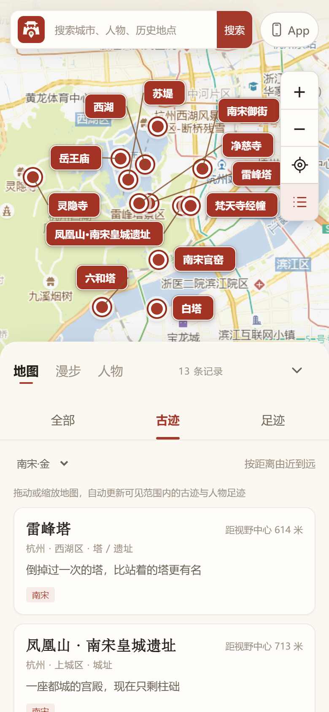
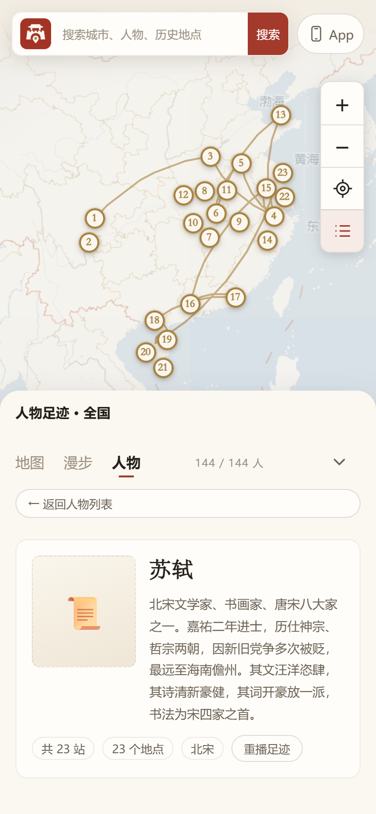

If you're heading to Hangzhou's Su Causeway for a weekend walk, a map can show you where to get onto it. Once you're by the lake, you might have another question. How did this causeway come to be?

I built Strata, a map of historic places. You can start with present-day streets, landmarks, and museums, see what happened there in the past, and find a few more places nearby worth walking over to.
<!--break-->

*An AI-generated illustration of an imagined city.*

## Start with one place and look back

Search for the Su Causeway (苏堤) in Strata and open the place details. You'll find the story of how Su Shi dredged West Lake during the Northern Song and used the silt to build a causeway. Read a little further and, by the Southern Song, “Spring Dawn on the Su Causeway” was already counted among the Ten Scenes of West Lake. A project to manage the lake had become part of the city's scenery.

*The Su Causeway entry shows a photo above its stories by dynasty. Photo by lienyuan lee. [Photo source](https://commons.wikimedia.org/wiki/File:%E8%A5%BF%E6%B9%96_West_Lake_-_panoramio_(9).jpg) · [CC BY 3.0](https://creativecommons.org/licenses/by/3.0/)*

Nearby Leifeng Pagoda has layers of its own. Its entry brings together the original construction under the kingdom of Wuyue, the collapse of the old pagoda, and the reconstruction on the original site. Even if you've been before, you might take another look at the remains beneath the new pagoda.

The name Strata refers to layers. I wanted visiting a place on the map to feel like turning through those layers. Open an entry to read a few short stories, see who was connected with the place, and find out what you can still see today. Where photos are available, they can help you recognize the building and its surroundings.

## Look nearby or pick a dynasty

If you feel like exploring, search for a city or use the location button to see what's nearby. Pan to another neighborhood and open the list to see the historic sites and traces of historical figures in the current map view. You can also look around a particular place from its detail page.

If you're interested in a particular period, filter the same map by dynasty. In Hangzhou, for example, choose Southern Song and Jin to find places connected with Lin'an, then open each one to read its story. You can pick a few stops before heading out and read a short entry once you get there.

*Selecting Southern Song and Jin in Hangzhou updates both the map markers and the list of historic sites.*

## Follow a person or take a walk

Search for Su Shi (苏轼) to browse a different way. Places connected with his life appear in chronological order, with the stops that can be located marked and linked on the map. Open one stop to read about that part of his life and, where there's an associated place, continue to its story.

*Su Shi’s map. The numbered markers correspond to entries you can browse one stop at a time.*

For a few stops in one city, try the themed walks. Hangzhou's “Half a Day in Southern Song Lin'an” brings together Phoenix Hill, Jingci Temple, Leifeng Pagoda, and Yue Fei Temple. You can check where they are and read their stories before you leave, then decide how many to visit based on the time you have.

## I used AI to write the software

I used AI to write Strata. Its contributions include the map, search, and detail pages, along with tools that check coordinates, dynasties, and the places referenced by routes. Take the dynasty filter. When you select Southern Song and Jin, the markers and the results in the list beside them both need to update. That's the kind of detail you need to check in the running app.

The historical content has its own editorial rules. For example, a memorial museum can be a place on the map. To record it as a stop in someone's life, there needs to be evidence that the person actually went there. When the location or the history of a proposed entry still needs checking, it stays on the research list until there's enough evidence to consider putting it on the map.

To try Strata, open it in your phone's browser. There's also an Android download on the home page. Search for somewhere you already know, read its story, then use the nearby option to see what else is around it. [Open the Strata history map](https://strata.enilu.cn/).
