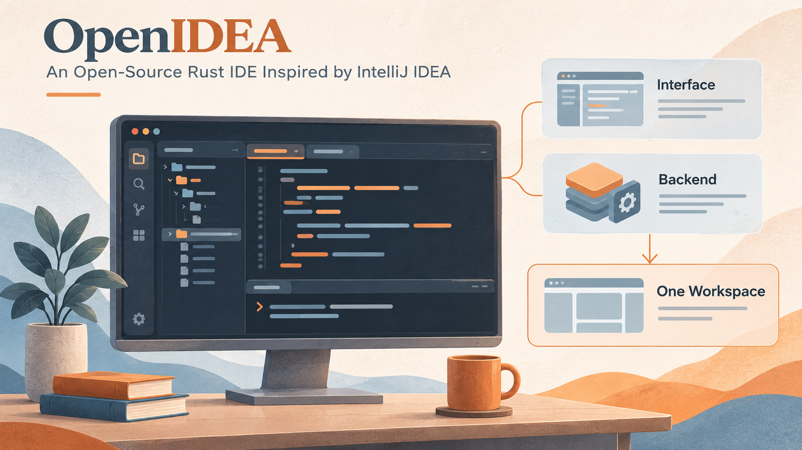

最近发现一个值得分享的开源项目：[OpenIDEA](https://github.com/l0ng-ai/openidea)。如果你习惯 IntelliJ IDEA 的快捷键、工具窗口和搜索方式，又想试试更轻量的开发工具，可以关注一下。

我在 Windows 上运行的版本，主程序加上 WebView2 子进程，合计占用约 600 多 MB 内存，也做了一点适合自己使用习惯的定制。
<!--break-->



*AI 生成的主题插画，用于表达开发工作台的组成，非 OpenIDEA 真实界面截图。*

## 熟悉的 IDEA 操作习惯，换了一套实现

OpenIDEA 用 Rust 构建核心，桌面端采用 Tauri。它围绕 IntelliJ IDEA 的操作习惯组织界面，包括快捷键、工具窗口和 Search Everywhere。对于已经习惯 IDEA 的开发者，这些入口让人更容易知道该去哪里找功能。

按[官方项目说明](https://github.com/l0ng-ai/openidea)，它覆盖编辑、代码辅助、调试、Git、终端、数据库和 HTTP 客户端，支持 60 多种语言，并提供 Windows、macOS 和 Linux 构建。项目采用 Apache 2.0 协议，与 JetBrains 没有隶属关系。

我愿意把它推荐为“轻量版 IDEA”来帮助理解它的方向，但实际选型仍要看具体项目。日常浏览代码、定位定义、搜索、查看 diff，与复杂框架分析、重构和完整插件生态，对 IDE 的要求有很大差别。熟悉的界面可以降低上手成本，能力是否够用，还得拿自己的项目验证。

## 为什么我暂时从 Zed 切换了过来

之前在[开发工具选型与打磨](/学习笔记/2026/10/22/AI时代我的开发工具选型与打磨)里推荐过 Zed，也为它做了一些适合自己的定制。这次暂时切换到 OpenIDEA，主要有两个原因。

首先是使用习惯。IDEA 的文件搜索和 Git 管理，一直是我用得很顺手的功能。用 OpenIDEA 时，又回到了熟悉的搜索入口、快捷键和差异查看方式，找文件、看改动都更合我的习惯。从 Zed 切换过来，这种熟悉感很舒服，也少了一些重新适应操作的成本。

另一个原因是 Java 代码导航。在我之前的 Zed 使用环境里，代码跟进和跳转能力还不够满足需求；补上 Java 语言服务（LSP）等相关工具后，编辑器连同相关进程的内存占用到了约 2 GB。对我当时的项目和配置来说，补齐这些能力以后，原本看重的低内存优势就不那么明显了。

所以，我现在更愿意先用 OpenIDEA 承接日常的代码阅读和修改：保留熟悉的 IDEA 操作方式，再继续观察它在 Java 项目中的表现。这是现阶段根据使用需求作出的调整，后面也会随着工具和项目的变化继续选择。

## 常用开发功能，也都放在了一起

除了熟悉的搜索和导航，OpenIDEA 也集成了运行调试、Git、数据库、HTTP 客户端和终端。几个值得关注的功能是：

- **Java 开发**：Maven/Gradle 依赖同步、运行配置和断点调试，并在补充 [Tomcat 运行](https://github.com/l0ng-ai/openidea/pull/392)、[类文件反编译](https://github.com/l0ng-ai/openidea/pull/657)等能力。
- **Git 与评审**：查看差异、提交历史和当前行 blame，也有 [GitHub PR 工具窗口](https://github.com/l0ng-ai/openidea/pull/477)，方便在 IDE 内看改动和评审反馈。
- **项目内的辅助工具**：查询数据库、发送 HTTP 请求、执行终端命令，不必每次都切到其他应用。

这些功能让它已经有了一套比较完整的 IDE 工作台形态。具体能否覆盖自己的项目需求，还要看语言服务和各项工具的实际表现。

## 也能把编码 Agent 放在代码旁边

OpenIDEA 本身还有 Agents 工作区。源码提供了 Claude Code、Codex 的原生协议适配，以及 ACP 接入路径，见[Agent 实现](https://github.com/l0ng-ai/openidea/tree/main/crates/ide-agent/src)。上游还支持把[会话停靠到 Agents 工具窗口](https://github.com/l0ng-ai/openidea/pull/588)，在对话和编辑器之间调整摆放方式。

这个布局很适合现在常见的开发过程：让 Agent 先读代码和提出修改，再在旁边查看它涉及的文件与差异；需要修正理解时，直接结合眼前的代码补充要求。对话、编辑器和 Git 入口在一起，人仍然可以逐段检查结果。

例如，可以先交给 Agent 一项边界清楚的小任务：“给列表增加日期筛选，沿用现有参数格式，并运行相关测试。”完成后打开 diff，核对前后端字段、默认值和清空行为，再决定是否接受。这里的重点是结果能被检查，而不只是多了一个聊天窗口。

Agent 的安装、登录和模型使用成本，仍取决于实际接入的工具与服务。OpenIDEA 是组织这些操作的界面，开源 IDE 本身不会让模型调用自动免费。

## 更新很快，也能看到 AI 参与维护的线索

上周留意它时，还只有 **800 左右的 Star**；一周过去，到 **2026 年 11 月 4 日**，就已经涨到了 **5800 左右**。代码更新也很密集：前两天检查上游时，比我本地的基线已经多了 200 个提交；仅北京时间 11 月 4 日 0 点至 14 点，[主分支记录](https://api.github.com/repos/l0ng-ai/openidea/commits?per_page=100&since=2026-11-03T16%3A00%3A00Z&until=2026-11-04T06%3A00%3A00Z)就有 89 次提交，包含社区贡献与合并后的变更。

更新里既有新功能，也有 Maven 依赖刷新、Windows Java 断点、Spring Boot 资源更新等日常问题的修复。看着不断刷新的提交，我也在想，作者是不是已经让 AI 日以继夜地帮忙维护了。

仓库里确实准备了面向 Agent 的开发流程：[AGENTS.md](https://github.com/l0ng-ai/openidea/blob/main/AGENTS.md)写明编码与检查规则，[`issue-fix`](https://github.com/l0ng-ai/openidea/blob/main/.agents/skills/issue-fix/SKILL.md)负责从问题复现到修复、提交 PR，[`verify`](https://github.com/l0ng-ai/openidea/blob/main/.agents/skills/verify/SKILL.md)则要求启动实际应用、操作界面并保存验证证据。

这些线索让我觉得，很可能有 AI 在持续参与开发和验收。至于是不是全天自动运行、人工审查有多少，公开记录还不能确认。一个支持 Agent 的 IDE，自己的维护也开始围绕 Agent 组织起来，这件事本身就挺有意思。

## 开源以后，可以顺手补上自己的使用习惯

我的个人定制版在这里：[enilu/openidea · feature/single-window-projects](https://github.com/enilu/openidea/tree/feature/single-window-projects)。如果你也希望在一个窗口里保留多个项目入口、按需切换当前项目，可以看看这个分支。

我在个人版本里加了一个窗口项目侧栏：保存常用项目列表，点击切换，支持折叠成图标栏；一个窗口只激活一个项目，切换时先关闭前一个项目的服务，再恢复新项目的编辑会话。

这些是个人分支增加的功能。对我来说，项目入口留在眼前、后台只运行当前项目，是希望保留的使用方式。

上游随后也加入了[多项目 Workspace 和窗口组](https://github.com/l0ng-ai/openidea/blob/main/docs/workspaces-and-window-groups.md)。Workspace 让多个项目参与同一会话的搜索、索引和运行；窗口组则在项目标签之间切换，并保持各成员会话与服务。它与我“只激活一个项目”的做法有不同取舍，后续同步时需要处理好项目的打开、关闭和恢复。

能查看实现、按需求调整，再继续跟进上游，是这个开源项目对我有吸引力的地方。当然，维护个人分支也有成本，尤其当上游开始改动同一部分功能时。

项目地址：[l0ng-ai/openidea](https://github.com/l0ng-ai/openidea)；安装包可从 [Releases](https://github.com/l0ng-ai/openidea/releases) 下载。
