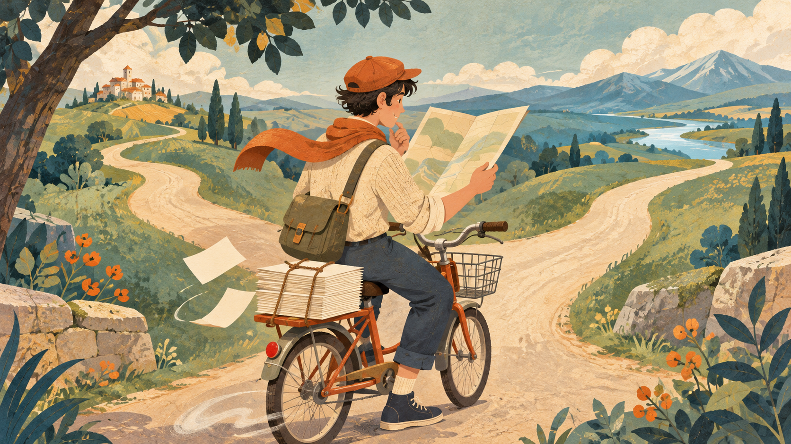

最近工作里 AI 用得越来越多，干活确实快了。但是我发现一个有点别扭的现象：事情做得快了，大家反而好像不太关注轻重缓急了。

尤其是安排工作、提需求的时候，新功能不停加，旧功能不停改。反正 AI 做得快，先做出来看看。人一直在忙，东西也一直在出，却很难沉下心来想想，现在到底该往哪个方向走。

原来担心走得太慢，现在有点担心，只顾着埋头走路了。
<!--break-->



*AI 生成的主题插画。*

## 做得快，慢慢变成了都可以做

以前提一个需求，多少要考虑下开发时间。这个做了，其他事情就得往后排，有些想法讨论完也就先放下了。

现在 AI 很快就能给出代码、页面和演示。以前因为费时间而被搁置的想法，又有了尝试的机会，这是好事。

但是另一种想法也容易跟着出现：既然不费多少工夫，那就一起做了吧。

领导也好，开发人员也好，都可能这样想。看见能很快做出东西，就容易跳过“现在值不值得做”，直接讨论“什么时候能给我”。

有些事情确实值得尽快尝试，但也有些，只是刚好被想起来了。想到的时间比较近，声音比较大，未必就该排在前面。

## 省了写代码的时间，其他事情还在

我觉得这里容易忽略一个问题：写出来便宜了，不代表这件事的全部成本都低了。

比如加一个入口，AI 可能很快就写好了。但是谁来确认规则，谁来测试，用户会不会困惑，和原有功能冲不冲突，后面改动要不要兼顾它，这些事情仍然有人要管。

同样，一个功能改来改去，代码可能每次都能很快调整。但是产品、开发、测试要重新理解，文档和使用说明也得跟着变。

AI 能同时处理很多任务，人不一定能同时理解那么多变化。代码出来得越快，需要人看懂和作决定的东西，也可能越积越多。

如果只拿生成代码的时间算工作量，就很容易低估这些事情。

## 东西一直在出，方向却可能越来越模糊

做完一个功能，可以演示，可以交付，也方便汇报。相比之下，坐下来想想该不该做，最后决定暂时不做，看起来就没那么有成果。

执行越来越快以后，这种差别可能更明显。今天加了几个功能，明天又改了几个页面，大家都觉得推进得挺快。

但是这些改动有没有让产品更好，可能还没来得及看。前一个功能刚上线，反馈没收齐，下一个方向又开始了。

这样忙上一段时间，系统里的东西越来越多，反而说不清现在最想解决哪个问题。

我担心的就是这个：用不断出现的新任务，代替对方向的思考。只要还有事情可以做，就不必面对“我们现在做的，到底有没有用”这个不太好回答的问题。

## 快一点试错，也得知道在试什么

当然，我不是觉得每件事都要开很久的会，想得万无一失才开始。很多问题，本来就得做出来、给人用，才知道答案。

AI 降低了尝试成本，这部分好处应该用起来。但是试之前，至少得知道自己想弄清楚什么。

比如一个功能没人用，是因为入口不好找，还是用户根本没有这个需要？这两种情况，接下来该做的事情就不一样。

如果只是因为入口改起来方便，就一遍遍改入口，可能忙了很久，仍然没碰到真正的问题。

试过以后，也得留时间看看结果。哪里有效，哪里没用，哪些可以停掉。否则只是不断开始新事情，很难说从中学到了什么。

## 省下来的时间，留一点用来想

我觉得 AI 普及以后，安排工作的难点也在变。以前要考虑怎么把事情做快，现在还要考虑，哪些事情即使做得快，也先别做。

尤其是带团队的人，不能因为实现方便，就把每个新想法都变成马上要完成的任务。新事情插进来，原来的重点怎么办，总得有个取舍。

开发人员也一样。不能因为 AI 很快就能改完，便觉得所有调整都值得接。把为什么要做、和眼前目标有什么关系问清楚，仍然是工作的一部分。

效率提高后，省下来的时间，如果全部塞进更多需求，思考方向的时间还是没有。工具换了，人可能只是换一种方式继续忙。

我更希望 AI 帮忙省下来的时间，能留一部分用来理解问题、观察结果，也允许自己暂时不动手。

走得快当然好。但是走了一段以后，总得抬头看看，还在不在自己想去的那条路上。
