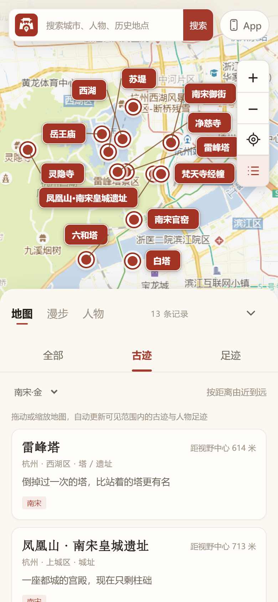
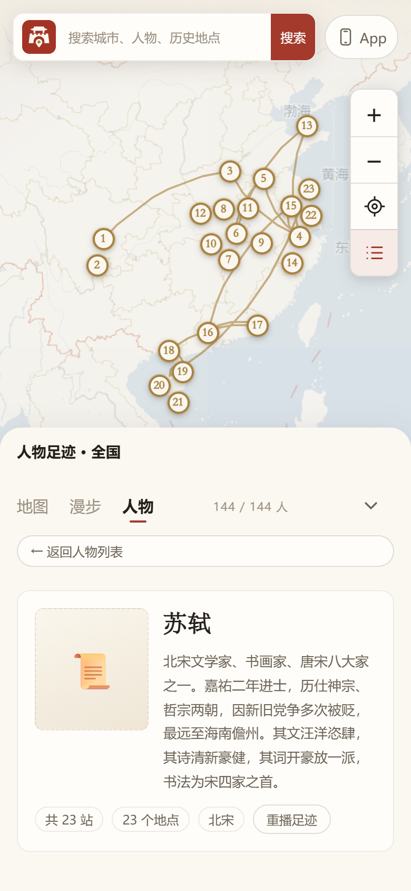

如果周末去杭州走一趟苏堤，地图能告诉你从哪儿上堤。到了湖边，还有个问题可以接着问：脚下这条堤，当年是怎么修起来的？

我做了一个叫 Strata 的历史地点地图。打开它，可以从今天的街道、古迹和博物馆出发，看看这里以前发生过什么，顺便找找附近还有哪些地方值得走过去看看。
<!--break-->



*AI 生成的主题插画，画的是一座想象中的城市。*

## 从一个地点往回看

在 Strata 里搜「苏堤」，打开地点详情，可以看到苏轼在北宋疏浚西湖、用挖出来的湖泥筑堤的故事。再往下读，南宋的人已经把「苏堤春晓」当成西湖十景之一。同一条堤，先是治水工程，后来成了城里的风景。

*苏堤详情页。上面是实景，下面按朝代读故事。实景照片由 lienyuan lee 拍摄。 [图片来源](https://commons.wikimedia.org/wiki/File:%E8%A5%BF%E6%B9%96_West_Lake_-_panoramio_(9).jpg) · [CC BY 3.0](https://creativecommons.org/licenses/by/3.0/)*

附近的雷峰塔也是这样。详情把几段经历放在一起，从吴越建塔，到旧塔倒塌，再到今天原址上的重建。即使已经去过，读到这里也可以再留意一下新塔下方的旧塔遗址。

Strata 这个名字有「地层」的意思。我想做的就是这种翻看一层又一层的感觉。点开一个地方，先读几段短故事，看看和哪些人有关、今天还能看到什么。有实景照片的地点，也可以先认一下建筑和周边环境。

## 从附近找，也可以按朝代找

想随便逛逛时，可以先搜一座城市，或者点定位看看周边。把地图移到另一片街区，打开列表，就能看看当前范围有哪些古迹和人物足迹。已经看中一个地方，也可以从它的详情继续查周边。

如果对某段历史感兴趣，可以在同一张地图上按朝代筛选。比如到了杭州，选「南宋·金」，就可以从地图上找跟临安有关的地点，再点进各自的故事。出门前可以用它挑几个想看的地方，到了现场也能打开读一小段。

*在杭州选中「南宋·金」后，地图标记和下方的古迹列表一起更新。*

## 跟着一个人，或者走一条路

搜「苏轼」，可以换一种看法。原本散在各地的足迹会按时间排出来，地图上能看见可定位的站点和连线。点开一站，可以读这一段经历，有关联地点时还可以继续看那里的故事。

*苏轼的足迹地图。编号对应下方可以逐站浏览的经历。*

想在一座城里走几站，可以看「漫步」。比如杭州的「南宋临安半日」，把凤凰山、净慈寺、雷峰塔和岳王庙放在一条主题路线里。出发前先看一下几个地方的位置和各自的故事，到现场再按自己的时间取舍。

## 这个项目是用 AI 写的

Strata 的程序是用 AI 编写的。地图、搜索和详情页这些看得见的功能，以及检查坐标、朝代和路线引用的工具，都是这个项目里 AI 参与的部分。拿朝代筛选举例，选中「南宋·金」以后，地图上的点和旁边列表里的结果都得跟着变，这样的细节需要在跑起来的页面上一起看。

历史内容也有自己的整理规则。比如一个人物的纪念馆可以是地图上的一个地点，要把它记为本人足迹，就要有他到过那里的依据。遇到位置或史实还需要核对的条目，先作为线索留着，等资料补齐了再考虑放到地图上。

如果想试一下，可以用手机浏览器直接打开 Strata，首页也有 Android 下载入口。先搜一个自己熟悉的地方就行，看完它的故事，再点一下「查此处周边」。[打开 Strata 历史地点地图](https://strata.enilu.cn/)。
